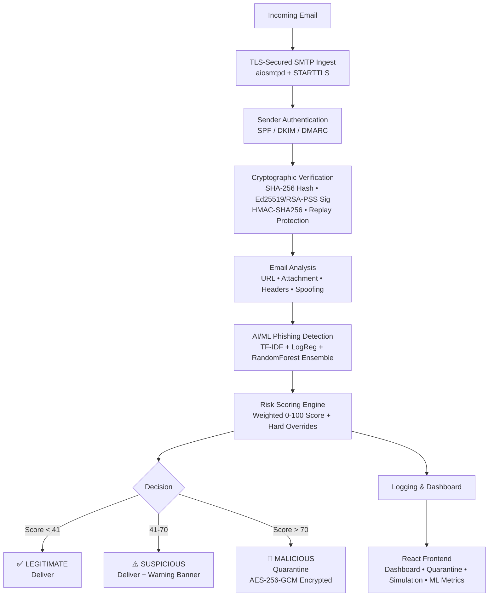

# PhishShield 🛡️

**Secure Email Gateway** | Team ZeroTrace | SPIT Mumbai | CNS Course Project

[](https://github.com/SwanandDixit/phishshield/actions)

PhishShield is a fully functional, production-grade secure email gateway that examines every incoming email through multiple cryptographic and ML-based security layers before delivery.

---

## 🏗️ Architecture



---

## 📊 ML Model Metrics (Real SpamAssassin Corpus)

| Metric | Score |
|--------|-------|
| **Accuracy** | 99.67% |
| **Precision** | 99.00% |
| **Recall** | 99.00% |
| **F1 Score** | 99.00% |
| **ROC-AUC** | 99.99% |

*Trained on 3,052 real emails from the SpamAssassin public corpus (2,551 legitimate, 501 spam). 80/20 stratified split. Model: VotingClassifier (LogisticRegression + RandomForest, soft voting).*

**Confusion Matrix:**
```
               Predicted-Legit  Predicted-Phish
Actual-Legit          510                1
Actual-Phish            1               99
```

---

## 🔐 Cryptography Design

| Purpose | Algorithm | Library |
|---------|-----------|---------|
| Email encryption at rest | AES-256-GCM | `cryptography` |
| Key derivation | HKDF-SHA256 | `cryptography` |
| Digital signatures | Ed25519 / RSA-PSS | `cryptography` |
| Message authentication | HMAC-SHA256 | stdlib `hmac` |
| Message integrity | SHA-256 | stdlib `hashlib` |
| Password hashing | bcrypt | `passlib` |
| Replay protection | Nonce+Timestamp cache | DB-backed |
| TLS | TLS 1.2 / 1.3 | stdlib `ssl` |

**Why Ed25519?** Fast (1 signature in ~50µs), small keys (32 bytes), strong security (equivalent to RSA-3072), resistant to timing attacks.

**Why AES-256-GCM?** Provides both encryption and authentication. Random 96-bit nonce per message prevents nonce reuse attacks. Tag prevents undetected tampering.

**Why HMAC over plain hash?** HMAC uses a shared secret key, preventing an attacker who modifies the message from recomputing the correct tag.

---

## 🚀 Quick Start (Local)

### Prerequisites
- Python 3.11+
- Node.js 18+
- OpenSSL (included with Git for Windows)

### 1. Clone & Setup

```bash
git clone https://github.com/YOUR_USERNAME/phishshield.git
cd phishshield

# Copy and edit environment file
cp .env.example .env
# Edit .env: set AES_MASTER_KEY, JWT_SECRET, ADMIN_PASSWORD
```

Generate AES master key:
```bash
python -c "import secrets,base64; print(base64.urlsafe_b64encode(secrets.token_bytes(32)).decode())"
```

### 2. Generate TLS Certificates

**Windows (PowerShell):**
```powershell
powershell -ExecutionPolicy Bypass -File scripts/gen_certs.ps1
```

**Linux/macOS:**
```bash
bash scripts/gen_certs.sh
```

### 3. Install Dependencies & Train Model

```bash
# Backend
python -m venv .venv
.venv/Scripts/activate  # Windows
# OR
source .venv/bin/activate  # Linux/macOS

pip install -e ".[dev]"

# Download real training data & train ML model
python -m backend.ml.download_data
python -m backend.ml.train

# Frontend
cd frontend
npm install
```

### 4. Run

**Backend:**
```bash
python -m backend.app.main
# API: https://localhost:8443
# SMTP: localhost:2525
```

**Frontend:**
```bash
cd frontend
npm run dev
# UI: http://localhost:5173
```

**Default admin credentials (from .env):**
- Email: `admin@phishshield.local`
- Password: (your ADMIN_PASSWORD from .env)

---

## 🐳 Docker

```bash
# Generate certs first
bash scripts/gen_certs.sh

# Build and run
docker-compose up --build

# App available at:
# https://localhost:8443  (API)
# http://localhost:3000   (Frontend)
```

---

## 📧 Sending Test Emails via SMTP

```bash
# Send a test email to the gateway (Python)
python -c "
import smtplib
from email.mime.text import MIMEText

msg = MIMEText('This is a test email from the terminal.')
msg['Subject'] = 'Test from CLI'
msg['From'] = 'sender@test.com'
msg['To'] = 'recipient@company.com'

with smtplib.SMTP('localhost', 2525) as s:
    s.sendmail('sender@test.com', ['recipient@company.com'], msg.as_string())
print('Sent!')
"
```

Then check `https://localhost:8443/emails/` (with JWT auth) or the UI inbox.

---

## 🎯 Attack Simulations

Each simulation generates **real crafted email payloads** sent through the actual pipeline:

| # | Scenario | What it tests |
|---|----------|---------------|
| 1 | **Phishing** | ML detection, URL analysis, suspicious TLDs |
| 2 | **Sender Spoofing** | SPF fail, DKIM fail, display-name spoof, lookalike domain |
| 3 | **Message Tampering** | Ed25519 signature fail, hash mismatch |
| 4 | **Replay Attack** | Nonce cache rejects second use of same signed nonce |
| 5 | **MitM** | Invalid key_id → sig fail, TLS not established |

### Run via API:
```bash
# Get auth token first
TOKEN=$(curl -sk -X POST https://localhost:8443/auth/login \
  -H "Content-Type: application/json" \
  -d '{"email":"admin@phishshield.local","password":"YOUR_PASS"}' \
  | python -c "import sys,json; print(json.load(sys.stdin)['access_token'])")

# Run phishing simulation (3 iterations)
curl -sk -X POST https://localhost:8443/simulate/phishing \
  -H "Authorization: Bearer $TOKEN" \
  -H "Content-Type: application/json" \
  -d '{"scenario":"phishing","iterations":3,"include_benign":true}'
```

### Run via UI:
Navigate to **Simulate Attacks** in the sidebar → click any scenario → **Run**.

---

## 🧪 Running Tests

```bash
# All tests
pytest backend/tests/ -v

# With coverage
pytest backend/tests/ -v --cov=backend --cov-report=html

# Specific test file
pytest backend/tests/test_crypto.py -v
pytest backend/tests/test_replay.py -v
pytest backend/tests/test_scoring.py -v
pytest backend/tests/test_simulation.py -v
```

---

## 📁 Project Structure

```
phishshield/
├── backend/
│   ├── app/
│   │   ├── main.py          # FastAPI app, startup, routers
│   │   ├── config.py        # Env-var settings
│   │   ├── database.py      # SQLAlchemy + SQLite
│   │   ├── models.py        # ORM models
│   │   ├── schemas.py       # Pydantic schemas
│   │   ├── deps.py          # JWT auth dependencies
│   │   ├── pipeline.py      # Full email analysis pipeline
│   │   ├── scoring.py       # Risk scoring engine
│   │   └── routers/         # FastAPI routers
│   ├── crypto/
│   │   ├── aes.py           # AES-256-GCM encryption
│   │   ├── signatures.py    # Ed25519 + RSA-PSS
│   │   ├── hmac_util.py     # HMAC-SHA256 (constant-time)
│   │   ├── hashing.py       # SHA-256 utilities
│   │   ├── replay.py        # Nonce cache / replay protection
│   │   └── tls.py           # TLS context builder
│   ├── analysis/
│   │   ├── email_parser.py  # RFC 2822 parsing
│   │   ├── spf_check.py     # SPF DNS verification
│   │   ├── dkim_check.py    # DKIM signature verification
│   │   ├── dmarc_check.py   # DMARC policy evaluation
│   │   ├── url_analyzer.py  # URL feature extraction (30+ features)
│   │   ├── attachment.py    # Attachment analysis + VirusTotal
│   │   ├── spoofing.py      # Display-name/lookalike/homoglyph detection
│   │   └── header_analyzer.py # Received chain, injection detection
│   ├── ml/
│   │   ├── download_data.py # Download SpamAssassin corpus / synthetic fallback
│   │   ├── features.py      # TF-IDF + engineered feature extraction
│   │   ├── train.py         # Model training + evaluation
│   │   └── predict.py       # Inference + top-feature explainability
│   ├── simulation/
│   │   └── scenarios.py     # 5 attack simulation scenarios
│   ├── smtp/
│   │   └── ingest.py        # aiosmtpd SMTP server
│   └── tests/               # pytest test suite
├── frontend/
│   └── src/
│       ├── pages/           # Dashboard, Inbox, Quarantine, Simulate, etc.
│       ├── components/      # Layout, VerdictBadge, RiskScore
│       └── lib/             # API client, auth helpers
├── scripts/
│   ├── gen_certs.ps1        # Windows TLS cert generation
│   └── gen_certs.sh         # Linux/macOS TLS cert generation
├── docs/
│   ├── THREAT_MODEL.md
│   └── CRYPTO_DESIGN.md
├── .env.example
├── docker-compose.yml
├── Dockerfile
└── PLAN.md
```

---

## 🔒 Threat Model Summary

See [docs/THREAT_MODEL.md](docs/THREAT_MODEL.md) for full details.

**Threats addressed:**
- Phishing / credential harvesting (ML + URL analysis)
- Sender spoofing (SPF/DKIM/DMARC + display-name checks)
- Message tampering in transit (Ed25519/RSA-PSS + SHA-256)
- Replay attacks (nonce + timestamp cache)
- Man-in-the-Middle (TLS enforcement + integrity checks)
- Data breach of stored emails (AES-256-GCM at rest)
- Brute-force auth (rate limiting + bcrypt)

**Limitations:**
- Self-signed TLS cert for development (add CA-signed cert in production)
- SQLite is sufficient for demos; use PostgreSQL in production
- DNS checks work in test mode without real DNS; live mode requires internet access
- SMTP server listens on port 2525 (non-privileged); real deployment needs port 25 with root or redirect

---

## 👥 Team ZeroTrace — SPIT Mumbai

**CNS (Cryptography and Network Security) Course Project**
Sardar Patel Institute of Technology, Mumbai — 2024-25

| Member | Role |
|--------|------|
| Team ZeroTrace | Full-Stack Security Engineering |

---

## 📄 License

MIT License — see LICENSE file.
